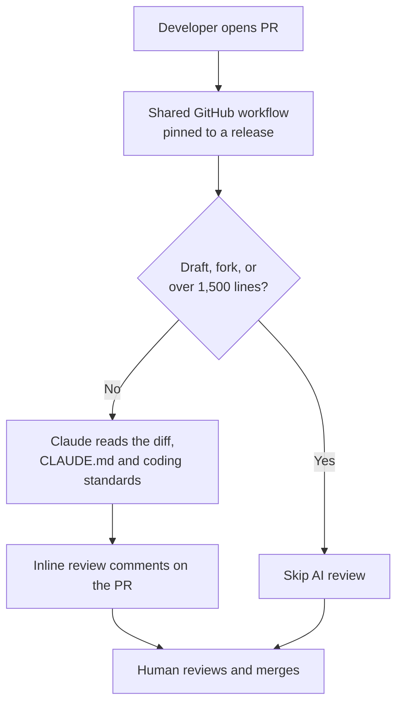
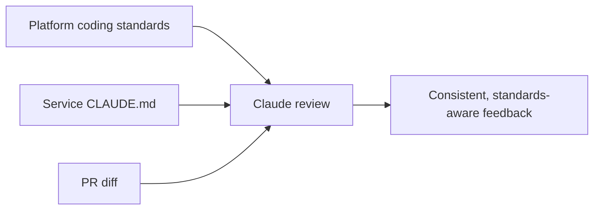
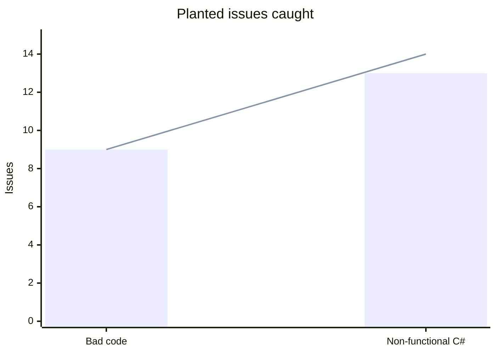
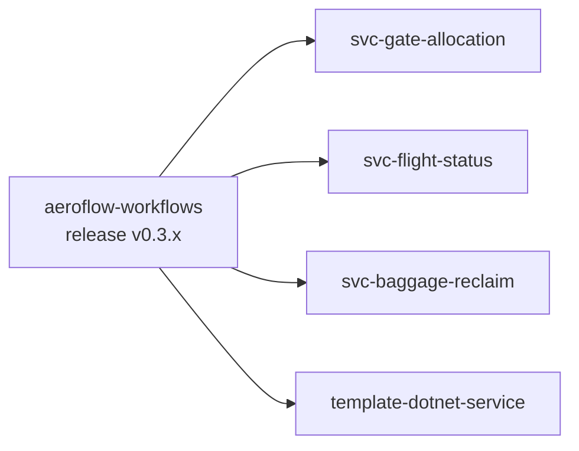

At AeroFlow Air, every pull request now gets a first review from Claude, Anthropic's AI model. It doesn't replace our engineers. It handles the routine checks quickly and the same way every time, so human reviewers can focus on design and intent.

## How the review flow works

When a developer opens a pull request, a shared GitHub workflow starts. That workflow lives in one central repo, and every service pins it to a released version. Some PRs are skipped: drafts, PRs from forks, and anything over 1,500 changed lines, because a PR that big needs a proper human review anyway.

For every other PR, Claude reads the code changes along with the repo's `CLAUDE.md` file and our platform coding standards. It then posts comments on specific lines of the PR. A human still reviews the PR and makes the call to merge.

## What it checks

- **Bugs and edge cases**, such as duplicate events, null handling and errors that get swallowed
- **Security issues**, such as hard-coded secrets and unsafe input
- **Our functional C# conventions**: `Result` types instead of exceptions, immutable records, and pure domain logic with no side effects
- **Tests and documentation**, both missing and out of date

## The CLAUDE.md setup

A generic AI reviewer gives generic advice. We wanted it to review against *our* standards, so we wrote them down in two layers. The platform coding standards apply to every service. Each service also has its own `CLAUDE.md`, which covers its events, its rules and the mistakes that are easy to make in that service.

## Testing it before trusting it

Before relying on it, we tried to catch it out. We opened pull requests with problems planted on purpose:

- **Bad-code test:** Claude caught **9 of 9** planted issues, including duplicate-event handling, a fake secret, swallowed errors and missing tests.
- **Style test:** in C# written against our functional style, it flagged **13 of 14** problems.

## What we learned

1. **The reviewer is only as good as the standards you write down.** Once the `CLAUDE.md` files existed, the style review improved a lot.
2. **Humans stay in charge of merges.** Claude gives advice, and people make the decisions.
3. **One shared, versioned workflow keeps reviews the same in every repo.** We change it in one place, release it, and each repo moves to the new version when it's ready.

## Next steps

- Tune the review prompts based on real PRs
- Track which comments developers actually act on, so we can measure whether the reviews help and not just how much they say
